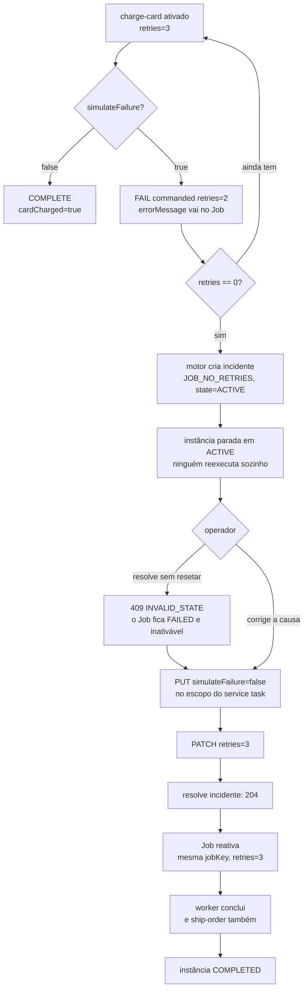

# LESSON-003 — Retries, incidentes e recuperação

Status: completed

> Idioma: **PT-BR**. Termos técnicos e nomes de API permanecem em english, porque é assim que
> aparecem na documentação, nos logs e no código. Ver [AGENTS.md](../../../../AGENTS.md).
>
> **Fato** = documentação oficial com versão e URL. **Observado** = saída real de execução.
> **Interpretação** = raciocínio do autor, que pode estar errado.

## Como ler esta lesson

Esta lesson ensina que `retries` é um contador no log, que zerar esse contador **materializa**
uma parada num artefato consultável — o incidente — e que recuperar esse artefato é uma decisão
de **autoridade**: os comandos existem no `CamundaClient`, mas não pertencem ao caminho do
worker. O limite não é capacidade da API; é responsabilidade.

Ela **não** ensina idempotência do efeito colateral, backoff exponencial, nem como monitorar
incidente em produção. Isso está nomeado em [O que esta lesson deliberadamente NÃO ensina](#o-que-esta-lesson-deliberadamente-não-ensina).

## Objetivo

Ao final, o leitor deve conseguir responder: *o que o motor escreve quando um Job esgota os
retries, quem pode desfazer isso, e por que a resposta não é o worker.*

## Contexto

A Lesson 002 ensinou o caminho feliz: o motor cria um Job, um worker o executa, a instância
chega ao fim. Esse caminho é o exceção, não o caso comum. Em produção o cartão é recusado, o
serviço externo está fora, o dado está incompleto.

O behavior ingênuo seria responder a isso com um `while` no worker: tentar de novo até dar
certo. Isso transforma uma falha de integração num loop infinito dentro de um processo que
ninguém consegue enxergar. O que se quer é o oposto — **parar de forma visível**.

## Conceito

### O problema

Quando um Job falha, a pergunta não é "quantas vezes ele tenta". É **o que existe no sistema
depois que ele para**. Um contador que chega a zero e some deixa o operador sem rastro. Um
incidente que chega a zero e fica parado é um objeto que alguém pode listar, avaliar e
resolver.

### A categoria

Camunda 8 separa **falha** de **parada**. Falhar é o worker_reportar que não conseguiu; parar
é o motor decidir que já houve tentativas suficientes. A primeira é escrita pelo worker, a
segunda é escrita pelo motor. Nenhuma das duas é um estado do processo — são estados do **Job**.

### A notação

O `retries="3"` no BPMN não é um parâmetro de política do Camunda 7. É um número que o motor
copia para o Job quando o cria, e a partir daí é o Job que o carrega:

```xml
<zeebe:taskDefinition type="charge-card" retries="3"/>
```

**Observado** — o Job já nasce com o valor, antes de qualquer worker existir:

```bash
$ curl -X POST http://localhost:8080/v2/jobs/search -H 'Content-Type: application/json' \
    -d '{"filter":{"type":"probe-003"}}' | jq -c '.items[]|{state,retries}'
{"state":"CREATED","retries":3}
```

### O vocabulário

| Termo | O que é, aqui |
|---|---|
| `retries` | contador que o motor carrega no Job; decrementa a cada falha |
| `errorMessage` | texto que o worker escreve no comando de falha; o incidente herda |
| `incident` | registro que o motor cria quando `retries` chega a 0, com estado próprio |
| `errorType` | `JOB_NO_RETRIES` é o que diz *por que* este Job parou |
| resolução | ato de declarar o incidente tratado; **não** é um "desfazer" |

### A forma

O worker tem os verbos da **execução**: falhar, concluir (e `newThrowErrorCommand`, para erro de
negócio). A recuperação não está entre eles. Em código:

```java
@JobWorker(type = "charge-card", autoComplete = false)
public void handleChargeCard(ActivatedJob job, @Variable(name = "simulateFailure") boolean simulateFailure) {
    if (decidir(simulateFailure, job.getRetries()) == Decisao.FALHAR) {
        jobClient.newFailCommand(job)
                .retries(job.getRetries() - 1)
                .errorMessage(FALHA)
                .send().join();
        return;
    }
    jobClient.newCompleteCommand(job).variables(Map.of("cardCharged", true)).send().join();
}
```

`autoComplete = false` não é estilo. O starter completa o Job sozinho quando o método
retorna; deixar ligado Mandaria `COMPLETE` junto com o `FAIL`, e quem estuda esta lesson
precisa que o comando seja o objeto de estudo.

## Modelo mental

**"O que quebraria sem isto?"**

- **Sem o contador**, o motor não teria como distinguir "uma falha" de "não há mais o que
  tentar". A parada seria um palpite do worker.
- **Sem o incidente**, a parada existiria só dentro do Job falhado. Quem olhasse a lista de
  Jobs veria `FAILED` e não saberia o que fazer — nem se já estava sendo tratado.
- **Sem `errorType`**, `JOB_NO_RETRIES` seria indistinguível de qualquer outra causa. O
  operador teria que abrir cada Job para ler a mensagem.
- **Sem a separação entre falhar e recuperar**, o incidente seria uma conveniência do worker e
  não uma decisão humana.

O ponto que resume a lesson inteira:

> **O worker reporta a falha; a recuperação é uma decisão de autoridade.** Em 8.9.22 o
> `JobClient` — a interface injetada no `@JobWorker` — expõe `newFailCommand` e
> `newCompleteCommand`, e **não** expõe reset de retries nem resolução de incidente. O
> `CamundaClient` **expõe** `newUpdateRetriesCommand`, `newResolveIncidentCommand`,
> `newSetVariablesCommand` e `newUpdateJobCommand`. O limite é **quem deve decidir**, não o que a
> biblioteca consegue chamar.

**Fato (8.9.22, verificado)** — as duas interfaces declaram conjuntos diferentes de métodos.
Fontes da tag `8.9.22`:
https://raw.githubusercontent.com/camunda/camunda/8.9.22/clients/java/src/main/java/io/camunda/client/CamundaClient.java
e https://raw.githubusercontent.com/camunda/camunda/8.9.22/clients/java/src/main/java/io/camunda/client/api/worker/JobClient.java .
A doc 8.9 mostra a sequência Java `newSetVariablesCommand → newUpdateRetriesCommand →
newResolveIncidentCommand` em https://docs.camunda.io/docs/8.9/components/concepts/incidents/ .

**Observado** — o comando e a saída contra o artifact correto (`camunda-client-java`, não
`zeebe-client-java`) estão em [evidence.md](evidence.md), seção D1. A distinção aparece nas duas
interfaces; não é uma classe órfã sem chamador.

## Camunda 7 → 8

**Fato (C7, documentação 8.7, verificada)** — em Camunda 7 o motor cobria a distância entre
*wait states* numa transação de banco, e um job executor separado continuava depois dos
*save points*. É essa fronteira transacional ACID compartilhada entre aplicação e engine que se
perde. Fonte:
https://docs.camunda.io/docs/8.7/components/best-practices/development/understanding-transaction-handling-c7/ .

Em Camunda 8, o comando de `FAIL` **já nasce com o efeito completo**: o motor grava o estado do
Job e levanta o incidente quando `remaining retries` chega a zero, dentro do próprio comando de
falha. **Fato (8.9, verificado)** —
https://docs.camunda.io/docs/8.9/components/concepts/job-workers/ . Não existe um segundo
comando "criar incidente" que pudesse faltar. O que vem **depois** são os comandos do operador —
corrigir a causa, atualizar retries, resolver — e esses sim são separados e têm ordem.

> **O que quebra é a fronteira transacional ACID compartilhada entre aplicação e engine.**
> "O banco virou log" é consequência, não causa. A perda da fronteira muda **quem é
> responsável** pela recuperação: ela sai da transação da aplicação e vira decisão explícita de
> operador.

**Observado** — a consequência prática é um `409` em vez de um lock, e ele prova a ordem dos
**comandos do operador** (`reset` antes de `resolve`):

```json
{"title":"INVALID_STATE","status":409,
 "detail":"Expected to resolve incident with key '2251799813774007', but job with key
  '2251799813774005' has no retries left. Please update the job retries and retry
  resolving the incident"}
```

Recuperar são **dois comandos do operador, com ordem**, não um "desfazer". O `409` não prova
não-atomicidade entre `FAIL` e incidente — esses chegam juntos no comando de falha. Ele prova que
o motor recusa `RESOLVE` enquanto o Job não tem retries.

## Onde esta lesson termina — e o que falta para responder

Termina quando a instância volta a andar depois de um incidente, com o operador como ator.
Não termina no desenho do que faria um agente de auto-recuperação, nem em como monitorar
quantos incidentes estão abertos. Isso está adiado.

## O que esta lesson deliberadamente NÃO ensina

- **Idempotência do efeito colateral.** O worker é determinístico e não cobra ninguém duas
  vezes. A Lesson 003 não resolve isso e diz isso.
- **Backoff exponencial.** Só foi observado o `retryBackOff` de janela única, passado no
  comando de falha.
- **Monitoramento e SLA de incidente.** Operate Cloud faz isso; aqui é cluster local.
- **Job worker versioning, multi-tenancy, autenticação, múltiplas partições, escala.**

## Exemplo mínimo

O menor exemplo é o próprio `apps/retry-worker`: dois service tasks, um falível com
`retries="3"`, e a sequência de três comandos que resolve o incidente.

## Implementação

`processes/003-retries-incidentes-recuperacao/order-fulfillment.bpmn` — `charge-card` com
`retries="3"`, e `ship-order` depois dele.

`ship-order` existe por um motivo pedagógico, não por necessidade: **sem ele, a instância
terminaria no service task falível e não haveria como provar que a recuperação leva a
instância até o fim.** Um processo que só trava não demonstra que o recovery funciona.

`apps/retry-worker` é um módulo **independente**, com o seu próprio pom, o seu BPMN e os seus
testes. Não toca na Lesson 002: cada app implementa o seu conceito sem arrastar o contrato do
anterior.

A decisão de falhar está isolada em `decidir(simulateFailure, retries)`, função pura. Testar o
método inteiro exigiria mockar uma cadeia de builders e o teste passaria a afirmar que a API
foi chamada, não que a decisão foi a certa.

O `simulateFailure` é uma **variável de processo**, não uma flag do worker. Isso é o que
permite que a correção da causa seja um ato do operador, e não um deploy.

## Execução

Pré-requisito: cluster local no ar (`cd infra/local/camunda-8.9 && docker compose up -d`, com
`8080` respondendo) e o worker em **background** — o `&` abaixo é o que libera o terminal para
os `curl`. Volte à raiz do repositório depois do `docker compose`. O sinal de pronto é
`Started RetryWorkerApplication` no log.

```bash
# 0. worker em background
./infra/local/mise.sh exec -- mvn -q -f apps/retry-worker/pom.xml spring-boot:run \
  > /tmp/opencode/retry-worker.log 2>&1 &
READY=0
for i in $(seq 1 60); do
  if grep -q 'Started RetryWorkerApplication' /tmp/opencode/retry-worker.log; then READY=1; break; fi
  sleep 1
done
[ "$READY" = 1 ] || { tail -30 /tmp/opencode/retry-worker.log; exit 1; }

# 1. deploy; a key vem do corpo aninhado, não do topo da resposta
DEPLOY=$(curl -sS -X POST http://localhost:8080/v2/deployments \
  -F "resources=@processes/003-retries-incidentes-recuperacao/order-fulfillment.bpmn")
PDK=$(printf '%s' "$DEPLOY" \
  | grep -o '"processDefinitionKey":"[0-9]*"' | head -1 | cut -d'"' -f4)

# 2. instância com a falha ligada; extrair a processInstanceKey
CREATE=$(curl -sS -X POST http://localhost:8080/v2/process-instances \
  -H 'Content-Type: application/json' \
  -d "{\"processDefinitionKey\":\"$PDK\",\"variables\":{\"simulateFailure\":true}}")
PIK=$(printf '%s' "$CREATE" \
  | grep -o '"processInstanceKey":"[0-9]*"' | head -1 | cut -d'"' -f4)

# 3. esperar o incidente; a busca devolve as três keys que o runbook precisa
INC=$(curl -sS -X POST http://localhost:8080/v2/process-instances/$PIK/incidents/search \
  -H 'Content-Type: application/json' -d '{}')
IK=$(printf '%s' "$INC" | grep -o '"incidentKey":"[0-9]*"' | head -1 | cut -d'"' -f4)
EIK=$(printf '%s' "$INC" | grep -o '"elementInstanceKey":"[0-9]*"' | head -1 | cut -d'"' -f4)
JK=$(printf '%s' "$INC" | grep -o '"jobKey":"[0-9]*"' | head -1 | cut -d'"' -f4)

# 4. o runbook, nesta ordem
curl -sS -o /dev/null -w 'PUT     %{http_code}\n' -X PUT \
  http://localhost:8080/v2/element-instances/$EIK/variables \
  -H 'Content-Type: application/json' \
  -d '{"variables":{"simulateFailure":false},"local":true}'
curl -sS -o /dev/null -w 'PATCH   %{http_code}\n' -X PATCH \
  http://localhost:8080/v2/jobs/$JK \
  -H 'Content-Type: application/json' -d '{"changeset":{"retries":3}}'
curl -sS -o /dev/null -w 'RESOLVE %{http_code}\n' -X POST \
  http://localhost:8080/v2/incidents/$IK/resolution \
  -H 'Content-Type: application/json' -d '{}'

# 5. a prova não é o 204: é o estado final da instância
curl -sS -X POST http://localhost:8080/v2/process-instances/search \
  -H 'Content-Type: application/json' \
  -d "{\"filter\":{\"processInstanceKey\":\"$PIK\"}}" \
  | jq -c '.items[]|{state,endDate}'
```

As chaves não são literais: vêm do corpo de cada resposta, com o mesmo `grep | cut` dos probes
de [evidence.md](evidence.md). `204` sozinho não prova nada — a prova é a instância chegar a
`COMPLETED` no `search` seguinte.

O runbook acima está também como requests versionados e asseridos, na pasta `50` da coleção:

```bash
node infra/local/collections/run-collections.mjs --folder "50 —"
```

São 13 requests e **36 asserções invariantes** na pasta `50` — nenhuma é condicional. A pasta
**exige** o `retry-worker` no ar: sem worker ninguém comanda `FAIL`, o Job fica em `CREATED` e o
incidente nunca nasce.

O total da coleção inteira depende de qual worker da Lesson 002 está no ar. A coleção tem 99
chamadas `pm.test(` no arquivo, das quais 10 ficam em branches condicionais da 002:

- com o `retry-worker` ligado e o `first-worker` da 002 **fora**, executam-se 6 desses branches →
  `35 request(s), 95 asserção(ões), 0 request(s) com falha` (modo registrado em D10);
- com os **dois** workers ligados, executam-se 4 → `35 request(s), 93 asserção(ões)`.

As 35 requests são as 22 da Lesson 002 mais as 13 da 003. A variação no total de asserções não é
falha: é o runner contando o ramo `504 sem worker` ou o ramo `200 com worker` do `awaitCompletion`.

## Falha / investigação / correção

O caminho de erro desta lesson produziu correções que ficam registradas em vez de apagadas —
inclusive as quatro que a revisão independente encontrou.

**O que parecia verdade:** que `TIMED_OUT` e `FAILED` fossem o mesmo evento visto de dois
lugares, e que um Job `TIMED_OUT` tivesse necessariamente perdido seu retry.

**O que a medição mostrou:** `errorMessage` **persiste** no registro do Job depois do backoff
(`{"state":"TIMED_OUT","retries":2,"errorMessage":"backoff probe"}`), mas não vem no payload
de ativação. São registros diferentes.

**Fato (8.9, verificado)** — timeout de ativação **não afeta** `remaining retries`
(https://docs.camunda.io/docs/8.9/components/concepts/job-workers/ ). A dúvida conceitual está
respondida pela documentação da versão fixada.

**N/A** — se `TIMED_OUT` consome retry, **medido de forma controlada nesta lesson**. O acervo
mostra um Job `TIMED_OUT` com `retries=2` depois do backoff, mas não houve experimento com
condição inicial e contagem explícitas. A lesson afirma que os estados são distintos, aponta o
Fato acima e **não finge ter feito o experimento**.

**Um probe invalidado.** A primeira medição de backoff "provou" que backoff não existe: a
ativação devolveu 1 Job. O Job devolvido era de uma execução anterior do mesmo tipo. O valor
verdadeiro, com tipo único por execução, é `0` dentro da janela e `1` depois. É o mesmo
defeito de escopo que a Lesson 002 cometeu e que foi corrigido em `5431834` — medir varrendo
estado acumulado do ambiente em vez do objeto do request.

### A hipótese mais perigosa, testada

Havia uma afirmação nesta lesson que era inferência pura: *resetar e resolver sem corrigir a
causa reesgota os retries*. Ela parecia óbvia, e "afirmação que parece óbvia" é o que este
laboratório trata como suspeito. O probe está em D11 e o resultado é mais útil que a confirmação.

**Confirma:** o mesmo `jobKey` consumiu os três retries de novo, voltou a `FAILED retries=0`, e o
motor abriu um **incidente novo** (`...006` → `...012`) enquanto o antigo ficava `RESOLVED`. A
instância parou no mesmo lugar.

**Acrescenta o que a inferência não previa:** os dois comandos responderam `204`. Não houve `409`,
não houve erro, não houve aviso. O modo de falha de pular a correção da causa é **silencioso**.
Um operador que resolveu para "limpar a fila" vê sucesso na tela e um incidente novo no dia
seguinte — e `incidentKey` diferente, o que faz parecer um problema novo.

É por isso que a ordem `corrigir -> resetar -> resolver` é ensinada como **runbook**, e não como
"sugestão de sequência": cada passo pressupõe que o anterior funcionou, e nenhum deles valida o
anterior.

## Implicações de arquitetura

- **O runbook é parte do desenho.** Se a correção da causa exigir deploy, o incidente é uma
  fila de trabalho do operador e o tempo de recuperação é tempo de deploy. A lição escolheu variável
  de processo justamente para tornar a recuperação um ato, não um ciclo de release.
- **Reset de retries é decisão de operador, não falta de API.** O `CamundaClient` tem
  `newUpdateRetriesCommand` e `newResolveIncidentCommand`; o `JobClient` do worker não tem. A
  fronteira é de **autoridade/responsabilidade**: se um agente receber um `CamundaClient` e
  decidir resolver incidentes, ele consegue — e aí quem pode recuperar passa a ser escolha de
  design de permissões, não propriedade do SDK.
- **`jobs/search` não serve para decidir prontidão.** O índice secundário atrasa: foi observado
  devolvendo `FAILED retries=0` logo após um `PATCH` que já tinha gravado `retries=3`.
  `activation` é o motor; `search` é uma projeção.
- **Recuperar não é reexecutar do zero.** O Job é o mesmo `jobKey`. Se o efeito colateral for
  externo, reexecutar pode cobrar duas vezes — e essa é a lacuna nomeada no escopo.
- **A `incidentKey` não identifica o problema; o `jobKey` sim.** Resetar e resolver sem corrigir
  a causa devolveu o mesmo Job a `FAILED retries=0` e abriu um incidente **novo**, com outra
  chave (`...006` → `...012`, evidence D11). Quem correlacionar incidentes por `incidentKey` vai
  tratar o mesmo problema como dois. Automação de agrupamento precisa do `jobKey`.
- **Resolver é reconhecer, não consertar — e o motor não avisa que você esqueceu.** Os três
  comandos devolveram `2xx` e o processo terminou no mesmo lugar. Não há erro, não há log, não há
  status diferente: só a repetição do sintoma. É por isso que o runbook tem que ser executado na
  ordem e com a correção da causa, e não "resolver para limpar a fila".

## Perguntas de entrevista

**P: o que acontece quando um Job esgota os retries?**
R: o motor escreve um incidente com `errorType=JOB_NO_RETRIES`, e a instância fica parada
esperando. Não há estado "desistido": há um incidente, com estado próprio.
*T:* mostrar o Job em `FAILED retries=0`, o incidente `ACTIVE` e a instância `ACTIVE`.
Ler o `errorMessage` no incidente e mostrar que veio do worker.

**P: por que o incidente é separado do Job?**
R: porque ele tem ciclo de vida, causa e dono diferentes. O Job é uma unidade de trabalho; o
incidente é uma unidade de decisão. Não são dois comandos: o `FAIL` que zera os retries já cria o
incidente no motor.
*T:* resolver o mesmo incidente duas vezes — a segunda responde `404 NOT_FOUND` com
`no such incident was found`, porque a primeira já removeu o incidente **no motor**; o `GET`
logo depois ainda pode mostrar `ACTIVE` por lag do índice secundário. Ver evidence D12.

**P: por que a ordem reset → resolve é obrigatória?**
R: porque são dois comandos **do operador**, separados, e o motor recusa resolver enquanto o Job
não tem retry. Não há transação que garanta os dois. Isso não diz nada sobre `FAIL` e incidente:
esses chegam juntos no comando de falha.
*T:* resolver primeiro e mostrar o `409 INVALID_STATE` cujo `detail` diz exatamente
`Please update the job retries and retry resolving the incident`. Ver evidence D2.

**P: o worker pode se recuperar sozinho?**
R: não — e a resposta certa não é "o SDK não consegue". O `JobClient` injetado no `@JobWorker`
tem os verbos de execução (`newFailCommand`, `newCompleteCommand`, `newThrowErrorCommand`). O
`CamundaClient` **tem** `newUpdateRetriesCommand`, `newResolveIncidentCommand` e
`newSetVariablesCommand`. A fronteira é de autoridade: a recuperação foi desenhada como decisão
de operador, e um agente que receber um `CamundaClient` deliberadamente cruza essa fronteira.
*T:* abrir as duas interfaces da tag 8.9.22 e mostrar os métodos de cada lado. Ver evidence D1.

**P: se o `CamundaClient` consegue atualizar retries e resolver incidentes, por que exigir um
operador?**
R: porque capacidade e autoridade são eixos diferentes. O motor não valida "causa corrigida": o
`204` de D11 prova que ele aceita reset e resolução com a causa intacta e abre um incidente novo.
Dar o comando a um agente sem dar a ele o critério de correção troca um incidente visível por um
loop silencioso. A fronteira existe para exigir um ato de decisão, não porque o método seja
inacessível.

**P: por que o runbook corrige a causa com variável local, e não de processo?**
R: porque `local: true` grava no escopo do element instance, e não substitui a variável de
processo. As duas coexistem: a do processo continua `true` depois da correção.
*T:* ler `variables/search` pelos dois `scopeKey` na mesma execução e mostrar `false` no
element instance e `true` na instância. Ver evidence D10.

**P: se eu resetar e resolver, o processo volta a andar?**
R: volta a *tentar*, não volta a *funcionar*. Sem corrigir a causa, o Job consome os retries de
novo e o motor abre um incidente novo, com outra chave — e os comandos anteriores responderam
`204` normalmente.
*T:* executar o runbook pulando a correção e mostrar `same jobKey`, `FAILED retries=0`, um
incidente novo `ACTIVE` e o antigo `RESOLVED`. Ver evidence D11. O entrevistador que espera
"sim, resolve" aqui está exatamente no erro que a lição quer expor.

**P: o que muda de Camunda 7 para 8 aqui?**
R: em C7 o motor cobria a distância entre *wait states* numa transação de banco — retry e
incidente caíam juntos, e o job executor separado continuava depois dos *save points*. Em C8 o
próprio `FAIL` já grava estado do Job e incidente. O que se perde é a fronteira ACID compartilhada
com a aplicação, e ela aparece na **recuperação**: corrigir, resetar e resolver passam a ser
decisões fora da transação da aplicação.
*T:* apontar o `409` de D2 como prova da **ordem dos comandos do operador**, não como prova de que
`FAIL` e incidente são atômicos ou não.

## Evidência

- [evidence.md](evidence.md) — o ciclo real, o `409`, o probe da inversão, os testes, a coleção e a prova por mutação
- [SPEC-003](../../../specs/003-retries-incidentes-recuperacao/spec.md)
- [ADR-0002](../../../adr/0002-camunda-8-version-pin.md)
- [Lesson 002](../002-deploy-instance-worker/lesson.md) — o caminho feliz e a correção da fronteira REST/gRPC
- [Incidentes (8.9)](https://docs.camunda.io/docs/8.9/components/concepts/incidents/)
- [Job workers (8.9)](https://docs.camunda.io/docs/8.9/components/concepts/job-workers/)
- [Transação em Camunda 7 (documentação 8.7)](https://docs.camunda.io/docs/8.7/components/best-practices/development/understanding-transaction-handling-c7/)

## Diagrama do ciclo observado

Diagrama de **sequência de comandos**, não C4: não é arquitetura de container, e não deve ser
lido como tal.



## Diagram Review

- [x] Sintaxe Mermaid validada por `docs/validate-mermaid.sh`
- [x] Todos os diagramas renderizam
- [x] Nível arquitetural correto — diagrama de sequência de comandos, explicitamente rotulado como não-C4
- [x] Componente lógico e container físico não estão misturados — o diagrama não mostra container
- [x] Todos os nós têm responsabilidade definida
- [x] Relações válidas
- [x] Direção das relações correta — o ciclo de falha desce, a recuperação sobe
- [x] Sem nós órfãos
- [x] Sem componentes não explicados
- [x] Sem componente fictício — os nós são comandos REST e respostas reais observadas
- [x] Sem contradição com o texto da lesson
- [x] Sem contradição com outros diagramas
- [x] Alegações sensíveis a versão verificadas contra a documentação da versão-alvo
- [x] Rótulos e documentação em PT-BR

## Critérios de conclusão

- [x] Conceito entendido
- [x] Modelo mental explicado
- [x] Distinção relevante C7 → 8 documentada
- [x] Escopo definido por SPEC
- [x] Experimento implementado quando aplicável
- [x] Testes executados — 16 verdes com prova por mutação, mais 13 requests / 36 asserções de coleção
- [x] Caminho de falha investigado quando relevante
- [x] Achados documentados a partir de execução real
- [x] Implicações de arquitetura documentadas
- [x] Revisão de entrevista concluída
- [x] Revisão independente concluída — primeira rodada `CHANGES_REQUESTED` (B1–B4), corrigida;
      re-revisão `APPROVED` sem blockers

## Registro da revisão independente

**Fato (revisão executada por agente independente, em duas rodadas).**

1. **Primeira rodada — `CHANGES_REQUESTED`.** Quatro blockers: B1, a tese "o SDK não consegue
   recuperar"; B2, o artifact errado inspecionado no D1; B3, `FAIL` e incidente descritos como
   dois comandos não atômicos; B4, resposta de entrevista apoiada em medição inexistente.
2. **Correção.** A tese virou a distinção entre `JobClient` e `CamundaClient`; o D1 foi refeito
   contra `camunda-client-java-8.9.22-sources.jar`; o eixo C7→8 foi reescrito com Fato 8.7 e Fato
   8.9; o D12 mediu a segunda resolução (`204` → `404 NOT_FOUND`). Os cinco achados não-bloqueantes
   da re-revisão (N1–N5) também foram fechados: ressalva de D12 na entrevista, prova final de
   `COMPLETED` no bloco de Execução, `newThrowErrorCommand` incluído no `rg` do D1, falha explícita
   no loop de espera do worker e redação do `TIMED_OUT`.
3. **Re-revisão — `APPROVED`, sem blockers.** O revisor confirmou B1–B4 fechados, não encontrou
   novos defeitos bloqueantes e adjudicou `001–005 (reenquadrado; ver roadmap)` como o intervalo
   correto do Módulo 1 em `docs/course-structure.md` — a sugestão anterior `000–005` duplicaria a
   Lesson 000, que pertence ao Módulo 0.

**Limitações que o revisor avaliou e decidiu que NÃO bloqueiam** — registradas, não omitidas:

1. **Herança de escopo do `local: true`.** Medido nos dois lados (D5 e D10): a variável local
   vale `false` no escopo do element instance e o escopo do processo continua `true`, ao mesmo
   tempo. O que não foi medido é o que um segundo `@JobWorker` leria — `ship-order` rodou, mas não
   lê `simulateFailure`. A lesson não afirma o valor lido por ele.
2. **`TIMED_OUT` e o contador.** `N/A` de medição controlada mantido em D7; o comportamento
   conceitual está coberto por Fato 8.9 com URL, então a lesson pode citar o Fato sem fingir
   medição.
3. **Concorrência e múltiplas partições.** O cluster é um Broker, uma partição, um worker. O
   `409` de D2 e a troca de `incidentKey` de D11 são observações deste cluster, e a lesson não as
   generaliza.

**Dead-end de ambiente registrado:** a reexecução da coleção e do `validate-collections.sh`
durante a revisão ficou bloqueada porque o host não alcança a porta `8080` — `curl` devolve `000`
e `ip route` mostra `172.18.0.0/16 via 10.212.134.138 dev fctvpnc48d5255`, rota de VPN que
captura a rede Docker. Os probes REST da D12 foram medidos por `curlimages/curl` **dentro** da
rede `camunda`, e os testes JVM e os diagramas foram reexecutados com sucesso. Ver evidence D10.