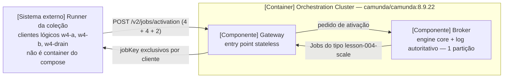

# LESSON-004 — Escala e concorrência do worker

Status: completed

> Idioma: **PT-BR**. Termos técnicos e nomes de API permanecem em inglês, porque é assim que
> aparecem na documentação, nos logs e no código. Ver [AGENTS.md](../../../AGENTS.md).
>
> A distinção entre **Fato** (documentação oficial, com a versão e a URL verificada), **Observado**
> (saída real de execução) e **Interpretação** (raciocínio do autor) não é opcional: é o principal
> mecanismo de proteção deste laboratório contra afirmações inventadas. Nenhuma seção desta lesson
> registra execução que ainda não aconteceu — o desenho do experimento está separado da evidência.

## Como ler esta lesson

Esta lesson mostra o que o motor garante quando **vários clientes pedem o mesmo `job type`** —
ativação exclusiva, limite por request e fila no Broker. Ela **não** configura um worker Java, não
explica os estados do Job como tese e não toca em particionamento.

## Objetivo

Ao final, o aprendiz consegue responder:

> *Dois workers do mesmo `job type` podem receber o mesmo Job? Quem limita a vazão e onde ficam os
> Jobs excedentes?*

Resposta esperada: **não** — o motor entrega cada Job a um único worker; o limite é
`MaxJobsToActivate` por ativação; o excedente fica enfileirado no Broker até outro cliente pedir.
Uma resposta que cite "`maxJobsActive` do Spring" como primeira linha já entrou na Lesson 014 e
pulou o mecanismo.

## Contexto

A Lesson 003 terminou com um único worker, um tipo de Job e um incidente recuperado por um
operador. A próxima pergunta de produção é: **se o volume crescer, o que eu aumento?**

A resposta ingênua é "o banco" ou "o Zeebe". A resposta correta começa em outro lugar: o worker é
um **cliente**, e foi ele quem assumiu o ritmo. Antes de falar em `maxJobsActive` ou thread pool —
tema da 014 — é preciso provar o contrato de entrega. Sem essa prova, o leitor terá duas crenças
falsas: de que escalar significa subir mais containers do motor, e de que "vários workers" implicam
processamento duplicado do mesmo Job.

## Conceito

A ordem é causal: problema → categoria → notação → vocabulário → forma.

### O problema: quem disputa o trabalho

Em Camunda 7, o paralelismo de service tasks é uma propriedade do **engine**: o *job executor*
busca Jobs no banco e disputa capacidade da transação. Em Camunda 8, o engine não busca nada —
quem busca é o cliente, chamando o Gateway. Isso desloca a pergunta "quantos trabalhos por vez?"
de uma configuração interna do motor para uma **decisão do cliente**.

### Categoria: worker é cliente, não engine

**Fato (8.9, URL verificada)** — https://docs.camunda.io/docs/8.9/components/concepts/job-workers/:

> "Job workers request jobs of a certain type on a regular interval (i.e. polling). This interval
> and the number of jobs requested are configurable in the Zeebe client."

**Interpretação** — o worker é o sujeito da frase: ele *pede*. **Escopo desta lesson:** no
experimento abaixo, o pedido é uma chamada REST e o Gateway responde. **Não se conclui daí que o
motor nunca empurra**: a mesma doc 8.9 descreve *job streaming*, em que o Gateway envia Jobs
ativados ao cliente, e a seção correspondente fica fora do escopo aqui (005 conceitual, 014 na
configuração). O que esta lesson prova é o contrato do pedido por ativação, não a ausência de
outras formas de entrega.

É por isso que "dois workers" aqui significa **dois clientes lógicos**, não dois processos do
sistema.

#### O que é

Um cliente que declara um `job type` e pede Jobs ao Gateway. Nesta lesson ele é representado por
um valor distinto de `worker` numa chamada `POST /v2/jobs/activation` — sem JVM nova.

#### Responsabilidade

Pedir um lote, receber o que o motor entregar e responder (completar ou falhar). O limite do lote
e o *timeout* do *lease* são parâmetros **do pedido**.

#### O que NÃO faz

Não armazena o estado do processo, não decide qual outro worker recebe o quê, não é uma réplica do
Broker. Os clientes lógicos (valores de `worker`) continuam falando com **um** Gateway e **um**
Broker neste laboratório; **nenhum cliente Java foi iniciado** — configurar `@JobWorker` é a 014.

#### Como se relaciona

**Fato (8.9, URL verificada)** — https://docs.camunda.io/docs/8.9/components/concepts/job-workers/:

> "Many workers can request the same job type to scale up processing. In this scenario, Zeebe
> ensures each job is sent to only one of the workers."

**Interpretação** — "Escala" é a presença de vários pedidos competindo, não a multiplicação do
motor. Observado em E7 e E11.

#### Evidência

Executada: E7 mostra os corpos das três ativações com `jobKey` disjuntos e o campo `worker`
preenchido; E11 reproduz a asserção pelo runner. O desenho está em [Exemplo mínimo](#exemplo-mínimo)
e a saída real em [evidence.md](evidence.md).

### Notação: o que a doc chama de propriedade de ativação

**Fato (8.9, URL verificada)** — a mesma página de job workers lista as propriedades que podem
ser enviadas ao pedir Jobs: `Worker`, `Timeout`, `MaxJobsToActivate` e `FetchVariables`.

Duas distinções de vocabulário que costumam virar erro de entrevista:

1. `MaxJobsToActivate` é limite **por request de ativação**, não um total acumulado vitalício do
   worker.
2. `Timeout` é o **lease** — quanto tempo o Job fica trancado para aquele cliente sem resposta.
   Ele **não** é política de retry e **não** altera `remaining retries`.

**Fato (8.9, URL verificada)** — a doc afirma que o timeout de ativação não afeta
`remaining retries`. **Correção da revisão:** o texto original dizia que isso "já havia sido medido
na Lesson 003". A 003 registrou o mesmo enunciado como **Fato (8.9) por documentação** e marcou a
medição controlada como `N/A` — não houve experimento que medisse timeout × retries. Aqui a frase
aparece só para impedir que `Timeout` seja lido como "tentativas".

### Forma: a fila

**Fato (8.9, URL verificada)** — a mesma página afirma:

> "Zeebe queues all jobs during any job worker outages, and progress resumes as soon as workers
> are available."

**Interpretação** — a fila não é um artefato novo que aparece quando o worker cai; é o próprio
log sendo consumido mais devagar do que é escrito. Onde o C7 via pressão no banco, o C8 vê
Jobs em estado ativável esperando o próximo pedido. É por isso que "não havia worker" e "o worker
era mais lento que a criação de instâncias" produzem a mesma observação.

### Limitação que precisa estar na mesma frase

**Fato (8.9, URL verificada)** — a entrega é *at least once*, e o worker deve ser idempotente.
**Interpretação** — exclusividade de entrega **não** é garantia de execução única: um Job pode ser
reativado se o *lease* expirar. A consequência é estudada na Lesson 015; aqui ela é apenas o
limite desta lesson.

## Modelo mental

A pergunta de um candidato forte para cada termo é *"o que quebraria sem isto?"*.

| Termo | O que quebraria sem ele |
|---|---|
| Cliente (`worker`) | Não existe quem peça; o Job espera para sempre na fila |
| `job type` | Não há como direcionar um pedido ao trabalho certo |
| Ativação exclusiva | Dois clientes processariam o mesmo efeito de negócio |
| `MaxJobsToActivate` | Um cliente pegaria tudo e os outros ficariam ociosos — ou o lote cresceria sem limite |
| `Timeout` / *lease* | Um cliente morto trancaria o Job para sempre |
| Fila no Broker | Picos de criação seriam perdidos em vez de esperados |

O modelo mental inteiro cabe numa imagem: **um balcão (o Broker), várias pessoas pedindo senha
(os clientes), cada senha entregue a uma pessoa só, e uma fila de senhas esperando no balcão.**

### Diagrama — C4 nível 2 (container)



**Leitura do diagrama:** há **um** container do cluster no `docker compose ps`. Os três clientes
são valores de `worker` emitidos pelo runner, não processos Java nem containers. Gateway e Broker
são componentes lógicos que rodam **dentro** daquele único container; o Broker guarda o log, o
Gateway só encaminha o pedido.

## Camunda 7 → 8

A fronteira transacional ACID compartilhada entre aplicação e engine é a **causa remota**: ao
desaparecer, o paralelismo saiu do *job executor* interno e foi parar no cliente. "O banco virou
log" é consequência e já foi ensinado na 001/003 — não é a tese desta lesson.

| | Camunda 7 | Camunda 8 |
|---|---|---|
| Onde mora o paralelismo | *job executor* dentro do engine | cliente externo pede Jobs |
| Quem entrega | engine, dentro da transação | motor, com entrega exclusiva a um worker |
| Unidade de vazão | pool / transação | `MaxJobsToActivate` por ativação + `Timeout` como *lease* |
| Excedente | disputa de capacidade do banco | fila no log, à espera de outro pedido |

**Limitação do ambiente:** o cluster local tem **1 Broker e 1 partição**. Nada nesta lesson prova
roteamento dependente da contagem de partições; isso pertence à Lesson 025.

## Onde esta lesson termina — e o que falta para responder

A 004 prova **o que o motor garante** na entrega. Ela não responde:

- por que um Job muda de estado e quais são esses estados → **005**;
- por que o cliente controla o próprio ritmo e o que acontece quando o cluster sinaliza
  sobrecarga → **005** (conceito);
- como configurar `maxJobsActive`, `pollInterval`, concorrência de handler, *graceful shutdown* e
  métricas em Spring Boot → **014**.

A fronteira não é o título da lesson vizinha: é a **pergunta respondida**. Aqui a resposta é sobre
entrega e fila; nas outras, é sobre ciclo de vida e sobre configuração.

## O que esta lesson deliberadamente NÃO ensina

- Particionamento, múltiplos Brokers, `HashMod` e roteamento por partição (001, 025).
- Configuração de Spring Boot, thread pool, `Job.YIELD`, métricas (014).
- *job streaming*, gRPC flow control e backpressure como tese (005, 014).
- Retries, `retryBackOff`, incidentes e runbook de operador (003).
- Idempotência do efeito colateral de negócio (015).
- Autenticação, multi-tenancy, Kubernetes, Connectors e Kafka (lessons posteriores).
- Benchmark, vazão em `jobs/s` ou contagem fixa de asserções — sem medição controlada, `N/A`.

## Exemplo mínimo

**Desenho executado** — ver E7 (corpos das ativações) e E11 (runner verde). Os números abaixo são
o plano que foi efetivamente rodado:

1. BPMN novo: Start → Service Task `lesson-004-scale` → End.
2. Pré-checagem: `POST /v2/jobs/search` deve devolver **0** Jobs. **Afirmação original (refutada,
   mantida visível):** `{"filter":{"type":"lesson-004-scale"}}`. Na reexecução isso devolveu os 10
   Jobs `COMPLETED` da rodada anterior — evidence E10. **Correção aplicada:**
   `{"filter":{"type":"lesson-004-scale","state":"CREATED"}}`, que devolveu `totalItems: 0`.
   Se devolver mais, o run aborta e o estado é limpo antes de medir.
3. Deploy e captura da key em `deployments[0].processDefinition.processDefinitionKey` — caminho já
   observado na 003.
4. Criar **10** instâncias com `runId` único, capturando as 10 `processInstanceKey`.
5. Três ativações em `POST /v2/jobs/activation`, com `worker` distinto:

   | Cliente | `maxJobsToActivate` | Resultado esperado |
   |---|---|---|
   | `w4-a` | 4 | 4 `jobKey` |
   | `w4-b` | 4 | 4 `jobKey`, disjuntos dos de `w4-a` |
   | `w4-drain` | 2 | os 2 restantes |

6. Completar os 10 Jobs ativados no mesmo script, evitando *lease* expirado.

**Asserção que prova o conceito:** os conjuntos de `jobKey` devolvidos a `w4-a` e `w4-b` são
**disjuntos**, cada um dos dois primeiros lotes tem **exatamente 4**, a união tem **8**, e os
**2** restantes continuam ativáveis até a terceira chamada. "Vários Jobs completaram" é checagem
secundária — prova que não houve perda, não prova exclusividade.

**Log: N/A** — não há JVM nova neste experimento; a evidência é o corpo da resposta do Gateway.
**Tempo/vazão: N/A** — o laboratório não faz benchmark.

## Implementação

Foram construídos três artefatos, nenhum deles um módulo Java — configurar `@JobWorker` é matéria
da 014:

1. `processes/004-escala-concorrencia-worker/lesson-004-scale.bpmn` — Start → Service Task
   `lesson-004-scale` → End, com `retries="3"` explícito e tipo distinto de 002 e 003.
2. Pasta `60 — Escala e concorrência do worker` na coleção Postman, com deploy e um request que
   executa o experimento via `pm.sendRequest`: 10 instâncias, três ativações (`4`/`4`/`2`),
   asserções de disjunção, 10 completions e poll da projeção secundária.
3. Documentação: [SPEC-004](../../../specs/004-escala-concorrencia-worker/spec.md) e
   [PLAN-004](../../../specs/004-escala-concorrencia-worker/plan.md), com o probe antes da
   implementação e as correções registradas no lugar.

## Execução

O cluster já estava no ar. A sequência real, com as limitações de ambiente, foi:

```bash
docker compose -f infra/local/camunda-8.9/docker-compose.yaml ps
docker run --rm --network camunda curlimages/curl:latest ... http://orchestration:8080/...
node infra/local/collections/run-collections.mjs --folder "60 — Escala e concorrência do worker"
```

O host não alcança a `8080` (rota VPN), então o probe rodou com `curlimages/curl` dentro da rede
`camunda`. O runner foi executado dentro da mesma rede, com uma cópia temporária da coleção cujo
`baseUrl` foi trocado para `http://orchestration:8080` — o arquivo versionado permanece com
`http://localhost:8080`. O validador foi executado contra uma cópia local da spec viva, pelo mesmo
motivo. Saída real em [evidence.md](evidence.md), E1–E18.

## Falha / investigação / correção

Três becos sem saída aconteceram **de verdade** nesta lesson e estão registrados com a saída que
os refutou:

1. **Health check inexistente (E1).** O plano mandava esperar `/actuator/health/status`; a
   sondagem devolveu `404`, e `/actuator/health` também. A prontidão passou a ser medida por
   `docker compose ps`. SPEC, PLAN e TASKS foram corrigidos sem apagar a afirmação errada.
2. **Pré-checagem enganosa (E10).** Após a primeira rodada, `/v2/jobs/search` com
   `filter.type` devolveu os 10 Jobs **COMPLETED**. O filtro passou a incluir `state: CREATED`.
   Sem isso, reexecutar a coleção seria reprovado pelos próprios Jobs concluídos.
3. **`header` como string (E10).** O `pm.sendRequest` do runner rejeitou
   `header: 'Content-Type: application/json'` com `Headers constructor: ...`. O padrão já usado no
   resto da coleção — `header: { 'Content-Type': 'application/json' }` — funciona.

A rota VPN voltou a capturar a rede Docker: `curl` ao host devolveu `000` com timeout, embora o
`docker-proxy` aceitasse a conexão TCP na `8080`. A medição rodou dentro da rede `camunda`; isso é
limitação de ambiente, não comportamento do Gateway.

Os riscos herdados de lessons anteriores, que **não** se concretizaram aqui porque foram medidos
antes: a 002 trocou `/v2/jobs/activation` por `/v2/jobs` (`404`) e concluiu que a REST não ativava
Job; a 001 aceitou `200` da SPA como resposta de API; a 003 "provou" ausência de backoff medindo
um Job de run anterior.

## Implicações de arquitetura

**Interpretação.** O custo de escalar está no cliente, não no motor — o que é bom porque o cliente
é descartável e o motor não precisa de mais réplicas para absorver picos de consumo. O preço é que
a vazão passa a ser uma propriedade **distribuída**: soma dos lotes pedidos por clientes
independentes, com o Broker como árbitro da entrega. Isso torna "capacidade do worker" uma
decisão de capacidade de clientes, e torna obrigatório medir por chave entregue — contar requests
não diz quem recebeu o quê.

O trade-off fica registrado sem exagerar: mais clientes aumentam a concorrência de consumo, mas
não aumentam a capacidade de **execução do efeito de negócio** se esse efeito for serializado
externamente. Esse caso é da 015.

## Perguntas de entrevista

1. **Dois workers do mesmo `job type` podem receber o mesmo Job?**
   **Resposta:** não. O motor garante que cada Job vá a um só worker. **Teste que sustenta:**
   ativações com `worker` distinto e asserção de disjunção entre os conjuntos de `jobKey`
   (evidence E7 e asserção reproduzida pelo runner em E11).

2. **O que limita a vazão de um worker e onde fica o excedente?**
   **Resposta:** `MaxJobsToActivate` limita o lote **por ativação**; `Timeout` é o *lease*. A vazão
   por unidade de tempo também depende do intervalo de *polling* do cliente — configuração da 014,
   não medida aqui. O excedente fica enfileirado no Broker. **Teste que sustenta:** lotes `4`/`4`/`2`
   com 10 Jobs criados e o terceiro lote ainda ativável (E7, E11).

3. **Se eu rodar mais duas instâncias do processo, preciso de mais brokers?**
   **Resposta:** não para consumir mais rápido — é o cliente quem pede. **Limite:** este lab tem
   1 partição, então nada aqui prova comportamento dependente de partição; a resposta é sobre
   escala de cliente, não de roteamento.

4. **Entrega exclusiva significa "exatamente uma vez"?**
   **Resposta:** não. A entrega é *at least once*; se o *lease* expirar, o Job pode voltar. O
   trabalho de tornar o efeito idempotente é da 015.

## Evidência

[evidence.md](evidence.md) contém E1–E18: probe de API, deploy, 10 instâncias, corpos verbatim das
três ativações, 10 completions, estados finais, latência de índice, correções do runner, execução
verde da coleção, ressalva da validação Mermaid, registro da revisão independente, a prova de que
`state: CREATED` seleciona Jobs vivos, a explicação do campo `variables` ausente no search e a pasta
`61` de prova manual no Postman, com a correção do poll da fila. Não foi executado nada que não
esteja lá.

- [SPEC-004](../../../specs/004-escala-concorrencia-worker/spec.md)
- [PLAN-004](../../../specs/004-escala-concorrencia-worker/plan.md)
- [TASKS-004](../../../specs/004-escala-concorrencia-worker/tasks.md)
- Lesson anterior: [003](../003-retries-incidentes-recuperacao/lesson.md)

## Diagram Review

```
DIAGRAMA: docs/lessons/004-escala-concorrencia-worker/lesson.md (bloco 1)
TÍTULO:  C4 L2 — dois clientes lógicos, um Gateway e um Broker dentro de um único container
VEREDITO: WARN — o diagrama em si passou em todos os critérios semânticos; o WARN é de ferramenta:
`docs/validate-mermaid.sh` no repositório real varre READMEs de `.opencode/node_modules` e reporta 2
falhas de sintaxe em snippets de terceiros, não versionados (evidence E13). A regra de
`.opencode/agents/diagram-reviewer.md` exige "todas as afirmações verificadas, sem WARN aberto" para
`PASS`, então o veredito honesto é `WARN`, não `PASS`.
```

A revisão semântica segue
[`.opencode/agents/diagram-reviewer.md`](../../../.opencode/agents/diagram-reviewer.md).

### Afirmações verificadas

- [OK] **`runner` é um sistema externo, não um container do compose** — `docker compose ps` em E1
  lista apenas `orchestration` e `connectors`; os três `worker` são valores emitidos pelo runner em
  E7.
- [OK] **Há um único container do cluster, `camunda/camunda:8.9.22`** — `docker compose ps` em E1,
  com `STATUS healthy`.
- [OK] **Gateway e Broker são componentes lógicos dentro daquele container, não containers
  separados** — `AGENTS.md`, regra "Componente, container e storage"; `docker compose ps` em E1 não
  mostra containers `zeebe`/`operate`/`tasklist`.
- [OK] **O Broker é a fonte autoritativa do log; o Gateway é entry point stateless** — `AGENTS.md`,
  mesma regra; doc 8.9 em https://docs.camunda.io/docs/8.9/components/concepts/job-workers/ (HTTP
  200 nesta sessão).
- [OK] **O cluster tem 1 partição** — `GET /v2/topology`, registrado em
  [002/evidence.md](../002-deploy-instance-worker/evidence.md): 1 broker, 1 partição,
  `replicationFactor: 1`. Por isso o diagrama não mostra roteamento por partição.
- [OK] **O pedido é `POST /v2/jobs/activation` com lotes `4 + 4 + 2`** — corpos verbatim em E7.
- [OK] **Os `jobKey` voltam exclusivos por cliente** — E7 (conjuntos disjuntos) e asserção
  reproduzida pelo runner em E11.
- [OK] **Sintaxe Mermaid renderiza** — `mmdc` local, bloco isolado com PNG gerado (22.769 bytes);
  procedimento do `docs/validate-mermaid.sh` em cópia isolada de `docs/` e `specs/`: 11 blocos, 0
  falhas. Fonte completa e a ressalva do repositório real em **E13**.

### Desvios

- [WARN] **`docs/validate-mermaid.sh` no repositório real reporta 51 blocos e 2 falhas** — as duas
  falhas são snippets ilustrativos com sintaxe inválida nos READMEs de
  `.opencode/node_modules/@mermaid-js/mermaid-cli`, não arquivos versionados. Correção estrutural
  (ignorar `node_modules` no script) fica fora do escopo da 004; registrada em E13.

### Não verificável neste ambiente

- Com 1 partição e 1 Broker, não há como observar roteamento dependente da contagem de partições
  nem entrega entre Brokers — Lesson 025. O diagrama não representa esses casos.
- Job streaming existe na doc 8.9, mas não foi exercitado: o experimento usa polling REST.

### Correção mínima

Nenhuma no diagrama. O `WARN` de ferramenta não altera o diagrama nem sua leitura; está registrado
em E13. Corrigir o script para ignorar `node_modules` seria refatoro estrutural, fora do escopo da
004 — o `WARN` permanece aberto e por isso o veredito é `WARN`.

### Checklist semântico

- [x] Nível arquitetural correto — C4 L2 com rótulo textual explícito; o BPMN não é desenhado como C4
- [x] Todos os nós têm responsabilidade definida
- [x] Relações válidas e direção correta — pedido vai do cliente ao Gateway; `jobKey` volta
- [x] Sem nós órfãos, componentes não explicados ou componentes fictícios
- [x] Sem contradição com o texto da lesson, com outros diagramas ou com a documentação 8.9
- [x] Rótulos e documentação em PT-BR

## Critérios de conclusão

- [x] Conceito entendido
- [x] Modelo mental explicado
- [x] Distinção relevante C7 → 8 documentada
- [x] Escopo definido por SPEC
- [x] Experimento implementado quando aplicável
- [x] Asserções da coleção executadas (E11: 2 requests, 9 asserções, 0 falhas; E7: disjunção de
      `jobKey` no corpo das respostas)
- [x] Testes de unidade Java: `N/A` — nenhum código Java novo nesta lesson, com o motivo escrito
- [x] Caminho de falha investigado quando relevante
- [x] Achados documentados a partir de execução real
- [x] Implicações de arquitetura documentadas
- [x] Revisão de entrevista concluída
- [x] Revisão independente concluída — primeira rodada `CHANGES_REQUESTED` (5 blockers de
      evidência/redação); segunda `CHANGES_REQUESTED` (1 blocker, `items[0]` em E11); terceira
      `APPROVED` sem blockers

## Registro da revisão independente

**Fato (revisão executada por agente independente, em três rodadas).**

1. **Primeira rodada — `CHANGES_REQUESTED`.** Cinco blockers de disciplina de evidência e redação,
   nenhum sobre o mecanismo: "dois clientes Java" onde o experimento usou clientes lógicos;
   timeout × retries atribuído como medição da 003 quando a 003 marcou `N/A`; "o motor não empurra"
   em contradição com *job streaming* na própria doc 8.9; `11/0` de Mermaid apresentado como
   resultado do repositório real; e o "Exemplo mínimo" ainda dizendo "não executado" com o filtro
   refutado por E10.
2. **Correção.** Os cinco blockers foram corrigidos mantendo a afirmação errada visível ao lado da
   correção. E13 registrou o `51/2` real do validador e a causa das falhas (snippets inválidos em
   READMEs de `.opencode/node_modules`); E15 mediu que `state: CREATED` **seleciona** Jobs vivos,
   não apenas exclui os concluídos.
3. **Segunda rodada — `CHANGES_REQUESTED`.** Um blocker: a correção de E11 apoiava a unicidade da
   versão em `jq -c '.items[0]'`, exatamente o padrão que o Requirement 3 da SPEC proíbe e que a
   002 registrou como armadilha. A busca foi refeita preservando a contagem — `total: 1`, um único
   item. Oito WARNs também foram fechados.
4. **Terceira rodada — `APPROVED`.** Sem blockers. O revisor confirmou E7/E11 intactos, o blocker do
   `items[0]` corrigido pela contagem, os WARNs fechados e a coerência do artefato com o status de
   revisão.

**Limitações que o revisor avaliou e decidiu que NÃO bloqueiam** — registradas, não omitidas:

1. **Diagram Review com veredito `WARN`, não `PASS`.** A regra de
   `.opencode/agents/diagram-reviewer.md` exige "sem WARN aberto" para `PASS`. O WARN é de
   ferramenta: `docs/validate-mermaid.sh` no repositório real varre READMEs de
   `.opencode/node_modules` e reporta 2 falhas de sintaxe em snippets de terceiros, não versionados
   (E13). O diagrama da 004 renderiza isoladamente; corrigir o script seria refatoro estrutural,
   fora do escopo.
2. **Latência da projeção secundária (~3 s).** E9 e E16: o `/v2/jobs/search` atrasa tanto na
   conclusão quanto na criação. Reexecutar a coleção nessa janela pode reprovar a pré-checagem
   por um Job recém-completado ainda projetado como `CREATED` — falso-negativo, não falso-positivo.
   Não foi introduzido retry na pré-checagem para não transformar a 004 em lição de polling (005).
3. **`variables` ausente no `/v2/jobs/search`.** E16 mediu `hasVariables: false` no item do search,
   ao contrário do payload de ativação de E7. O `runId: null` de E15 é limitação da projeção, não
   perda de variável.
4. **Reprodutibilidade do runner.** A execução usou uma cópia temporária da coleção com `baseUrl`
   apontando para a rede interna do compose, porque o host não alcança a porta `8080`. A cópia, o
   comando e o resultado estão em E11; o validador foi reexecutado contra a spec viva (E12).
5. **Concorrência lógica e cluster de 1 partição.** A disjunção de `jobKey` prova entrega exclusiva
   entre pedidos, não simultaneidade temporal; com 1 Broker e 1 partição não há roteamento
   dependente de partição — Lesson 025. A renomeação dos títulos 005 e 014 na roadmap foi
   adjudicada pelo revisor como coerente com a fronteira de escopo.

---

## Checklist do autor, antes de pedir revisão

1. Toda afirmação versionada tem URL verificada, ou está marcada como não verificada.
2. Todo caminho, nome de arquivo, porta e comando citado saiu de um comando real, não de memória.
3. Toda conclusão decorre de evidência, não de analogia com Camunda 7.
4. Nenhum componente foi contado por nome de componente lógico.
5. Nenhuma distinção foi feita entre Camunda 7 e Camunda 8 como se fossem intercambiáveis.
