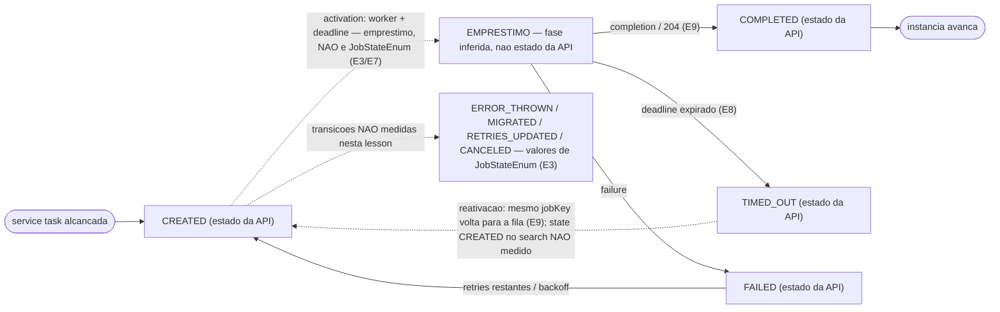

# LESSON-005 — Ciclo de vida do Job e backpressure

Status: completed

> Idioma: **PT-BR**. Termos técnicos e nomes de API ficam em inglês, porque é assim que aparecem na
> documentação, nos logs e no código. Ver [AGENTS.md](../../../AGENTS.md).

## Como ler esta lesson

Esta lesson responde uma pergunta que a 004 deixou aberta: **o que acontece com um Job entre a
ativação e o `completion`, e o que acontece quando o cliente não completa?** ~~Ela não ensina a
configurar um worker Java — ensina o contrato do Job como entidade com estado, prazo e nova
atribuição.~~

> **Correção de escopo (reabertura em 19/11/2026).** A frase riscada é a versão `completed` REST-only.
> O usuário pediu um projeto Java; a lesson voltou a `ready` e ganhou `apps/lifecycle-worker`. O
> worker **usa** o contrato do Job — ele não ensina a configurar o cliente, que permanece na 014.

O que ela explicitamente **não** faz: não prova `429`/`503` por carga, não mede vazão, ~~não escreve
código Java~~ e não repete escala de workers (isso é a 004). O módulo Java adicionado não mede vazão
nem configura polling; a frase riscada fica como registro da decisão anterior.

## Objetivo

Ao final, o leitor consegue responder sem consultar notas:

1. Por que "o Job ficou perdido" é uma descrição errada de um `TIMED_OUT`.
2. O que `timeout` controla e o que `requestTimeout` controla — e por que são duas coisas
   diferentes.
3. Por que um timeout **não** consome `retries`, mas ainda assim exige código idempotente.
4. Por que `state: ACTIVATED` não é um valor que a API v2 de busca devolve.
5. Onde o worker controla o próprio ritmo, e o que "backpressure" significa nos dois sentidos usados
   pela documentação oficial.
6. Por que um worker Java com `autoComplete = false` não conclui o Job ao retornar — e por que o
   mesmo `jobKey` voltando é a prova, não a contagem de logs.

## Contexto — o problema que esta lesson resolve

A Lesson 004 provou a entrega exclusiva: três clientes pediram o mesmo `job type`, receberam
`4 + 4 + 2` `jobKey` distintos e completaram os 10. Mas uma execução manual deixou um rastro:

- 89 Jobs, dos quais **4 `TIMED_OUT`**;
- os 4 tinham o mesmo `worker: w4-a` e o mesmo `deadline`;
- `retries: 3` intactos;
- as 4 instâncias correspondentes continuavam `ACTIVE`.

**Observado** na sessão de 17/11/2026 (commit `afb9384`, branch `lesson/004-...`, E18 daquela
lesson). O diagnóstico foi: ativação sem `completion` dentro do prazo. A recuperação foi uma nova
ativação com `w4-recupera`, devolvendo os **mesmos** `jobKey`, seguida de quatro `completion` com
`204`.

A pergunta que sobra não é "como recupero?" — isso já foi feito. É: **por que o Job voltou, e por
que o motor o considerou livre para voltar?** É o que esta lesson explica.

## Conceito — em ordem causal

### 1. Ativar é empréstimo, não conclusão

**Fato (Camunda 8.9, verificada em 19/11/2026):** o Job é "considerado ativado até ser completado,
falhado ou até o timeout da ativação expirar" — *"Such a job is considered activated until the job
is completed, failed, or the job activation times out."* Fonte:
https://docs.camunda.io/docs/8.9/components/concepts/job-workers/ .

Há, portanto, dois comandos distintos, com responsabilidades distintas:

| Comando | O que faz | O que NÃO faz |
|---|---|---|
| `POST /v2/jobs/activation` | empresta Jobs por um prazo | não executa lógica de negócio, não conclui a instância |
| `POST /v2/jobs/{jobKey}/completion` | devolve o resultado e avança a instância | não escolhe qual Job será entregue a quem |

A "trabalho" do service task nesta lesson é um *no-op*: o completion **é** o trabalho. O que se
estuda é o protocolo de entrega, não uma regra de negócio.

### 2. O `deadline` é a prova do empréstimo

**Observado (spec viva do cluster, 19/11/2026):** o schema `ActivatedJobResult` declara `deadline`
como campo obrigatório, descrito como *"When the job can be activated again, sent as a UNIX epoch
timestamp"*. O payload de ativação também traz `worker`, `retries`, `jobKey` e `variables`.

**Interpretação:** o `deadline` é o horário em que o motor volta a considerar aquele Job
disponível. Antes dele, outra ativação não recebe o mesmo `jobKey`; depois dele, **pode** receber.
O `worker`
é rótulo de auditoria — a doc 8.9 diz explicitamente *"The name of the worker activating the jobs,
mostly used for logging purposes"*.

**Observado (E8):** no payload de ativação o `deadline` é `int64`
(epoch ms); no `/v2/jobs/search` da rodada da 004 ele apareceu como string ISO
`2026-11-17T20:52:29.023Z`. São representações diferentes do mesmo instante — comparar os dois como
texto é erro de leitura, não divergência de motor.

### 3. Estado interno ≠ estado na projeção

**Fato (Camunda 8.9, verificada em 19/11/2026):** o Job é uma entidade com máquina de estados; cada
transição só é aplicável em um estado específico — *"it is not possible to complete a job when it
is in state CREATED"*. Fonte:
https://docs.camunda.io/docs/8.9/components/zeebe/technical-concepts/internal-processing/ .

**Observado (spec viva do cluster, 19/11/2026):** o enum `JobStateEnum` exposto por
`POST /v2/jobs/search` tem exatamente oito valores:

```text
CANCELED, COMPLETED, CREATED, ERROR_THROWN, FAILED,
MIGRATED, RETRIES_UPDATED, TIMED_OUT
```

**Interpretação — dead end registrado:** `ACTIVATED` e `ACTIVATABLE` **não** aparecem nesse enum.
`ACTIVATABLE` é mencionado na doc 8.9 como estado interno do backlog, mas não é um valor que a API
REST de busca devolve. Afirmar "o search mostrou `ACTIVATED`" seria inventar um estado. A ativação
é inferida por `worker` + `deadline` no payload de ativação, não por um `state` no search.

### 4. Timeout: o que muda e o que não muda

**Fato (Camunda 8.9, verificada em 19/11/2026):** se o Job não é completado nem falhado dentro do
`timeout` de ativação, o Zeebe o reatribui a outro worker, e isso **não afeta o número de retries
restantes**. A doc também avisa que dois workers podem trabalhar no mesmo Job simultaneamente; só
um `completion` é aceito, e o outro recebe `NOT FOUND`. Conclusão oficial: o sistema é *at least
once* na entrega, e o código do worker **deve** ser idempotente. Fonte:
https://docs.camunda.io/docs/8.9/components/concepts/job-workers/ .

**Fato (Camunda 8.9, verificada em 19/11/2026):** o `timeout` pode ser alterado depois da ativação.
A spec viva do cluster expõe `PATCH /v2/jobs/{jobKey}` com `changeset.timeout` em milissegundos — o
equivalente REST do `UpdateJobTimeout` descrito na doc.

**Observado (E11):** o `PATCH {"changeset":{"timeout":3000}}` **encurtou** o prazo — o Job voltou
antes do `deadline` original de 120 s. O `deadline` devolvido na reativação pertence ao **novo**
lease de 60 s, não ao PATCH. A hipótese do rascunho ("estende") foi refutada e mantida visível na
seção **Correções** de `evidence.md`.

Daqui vem a frase que a lesson quer fixar:

> `TIMED_OUT` não é falha de negócio, não é retry consumido e não é Job perdido. É o prazo do
> empréstimo que acabou. O Job volta para a fila com o mesmo `jobKey`.

### 5. `timeout` e `requestTimeout` são dois relógios

**Fato (Camunda 8.9, verificada em 19/11/2026):** *long polling* mantém a request aberta enquanto
não há Jobs disponíveis; a request termina quando pelo menos um Job aparece. O parâmetro é
`request-timeout`. Fonte:
https://docs.camunda.io/docs/8.9/components/concepts/job-workers/ .

**Observado (spec viva do cluster, 19/11/2026):** `POST /v2/jobs/activation` aceita
`requestTimeout` (int64, ms), com a semântica literal da spec:

```text
O request será concluído quando pelo menos um job for ativado ou após o requestTimeout.
requestTimeout = 0  -> timeout padrão
requestTimeout < 0  -> long polling desligado, resposta imediata mesmo sem jobs
```

| Parâmetro | Quem define | O que limita |
|---|---|---|
| `timeout` | cliente, por ativação | quanto tempo o Job fica emprestado a este cliente |
| `requestTimeout` | cliente, por ativação | quanto tempo a HTTP request fica aberta esperando um Job |

Confundir os dois é o erro mais comum: aumentar `requestTimeout` **não** protege um Job que está
sendo processado; aumentar `timeout` **não** faz a request esperar mais pela fila.

### 6. Backpressure — duas acepções, uma distinção necessária

A roadmap chamou a 005 de "ciclo de vida e backpressure". A documentação oficial usa a palavra em
dois contextos que **não são o mesmo mecanismo**:

**Fato A — backpressure do broker (8.9, verificada em 19/11/2026):** quando o broker recebe mais
requests do que consegue processar com latência aceitável, ele rejeita algumas com *resource
exhausted*; não existe limite fixo configurado, o limite é adaptativo e por partição. `CompleteJob`
e `FailJob` são aceitos mesmo sob backpressure. Fonte:
https://docs.camunda.io/docs/8.9/components/zeebe/technical-concepts/internal-processing/ . Na API
REST isso aparece como `503` com `RESOURCE_EXHAUSTED` no título do erro — ver
https://docs.camunda.io/docs/8.9/apis-tools/orchestration-cluster-api-rest/specifications/create-deployment/ .

**Fato B — backpressure no job streaming (8.9, verificada em 19/11/2026):** no caminho de push, o
gateway só envia o que o cliente consegue consumir; se os buffers enchem, o cliente é marcado como
`not-ready` e o Job é redirecionado ou devolvido ao broker. Fonte:
https://docs.camunda.io/docs/8.9/components/concepts/job-workers/#backpressure .

**Interpretação (decisão de ensino):** a tese desta lesson é o **controle de ritmo pelo cliente** —
"os workers pedem Jobs, então controlam a taxa com que assumem trabalho", nas palavras da doc 8.9.
O `429`/`503` por sobrecarga do broker é um mecanismo **do servidor**, não a forma como o worker
controla seu ritmo. Vamos nomear os dois, mas **não vamos afirmar ter medido `503`**: o cluster
deste laboratório não tem carga para isso. Fica como `N/A` com motivo em `evidence.md`.

## Modelo mental

| Pergunta | Resposta | O que quebraria sem isto |
|---|---|---|
| Por que o Job volta depois do timeout? | Porque o prazo do empréstimo acabou | Um worker travado sequestraria o Job para sempre |
| Por que `retries` não cai? | Timeout não é falha de negócio | Um cliente lento esgotaria retries sem nenhuma exceção real |
| Por que idempotência mesmo assim? | O mesmo `jobKey` pode ser entregue duas vezes | Efeito colateral duplicado em `at least once` |
| Por que `requestTimeout` existe? | Evita mil requests inúteis com fila vazia | Recurso desperdiçado nos dois lados da conexão |
| Por que `ACTIVATED` não aparece no search? | A projeção expõe outro conjunto de estados | O leitor inventa um estado que a API não tem |

## Diagrama — transições do Job (não é C4)

Este é um diagrama de **transições conceituais da entidade Job**, não um C4. Caixas sólidas são
valores de `JobStateEnum` observados na spec viva (E3) ou exercitados no experimento (E7–E11). A caixa
tracejada é a **fase de empréstimo**, inferida de `worker` + `deadline` no payload de ativação — ela
**não** é um valor de estado exposto pela API. As setas tracejadas indicam afirmações que não foram
medidas nesta lesson.



Leitura do diagrama: uma ativação **não** troca o `state` para `ACTIVATED`. Ela cria uma janela de
emprestimo com `worker` e `deadline`. Dessa janela saem três caminhos — `completion`, `deadline
expirado` e `failure` — e só o segundo é medido aqui: `CREATED → (emprestimo) → TIMED_OUT →
reativacao → completion`. O caminho de `failure` é Fato (E1), não Observado nesta lesson.

## Camunda 7 → 8

**Fato (C7, doc 8.7 verificada na Lesson 003):** no Camunda 7 o *job executor* vive dentro do
engine e disputa capacidade da transação de banco entre *wait states*. Fonte:
https://docs.camunda.io/docs/8.7/components/best-practices/development/understanding-transaction-handling-c7/ .

**Fato (C8, 8.9, verificada nesta lesson):** o cliente pede Jobs e recebe um prazo; o motor
reatribui quando o prazo expira.

**Interpretação:** o eixo obrigatório continua sendo a **fronteira transacional ACID compartilhada
entre aplicação e engine** — ela foi perdida, e por isso o "trabalho" saiu do engine e foi parar no
cliente. "O banco virou log" é consequência. Aqui a consequência aparece de forma bem concreta: o
estado do negócio e o estado do Job não são mais um único `commit`; entre o `activation` e o
`completion` existe uma janela, e é essa janela que o `timeout` limita.

| | Camunda 7 | Camunda 8 |
|---|---|---|
| Quem guarda o "estado do trabalho" | transação no banco, junto com o engine | log do broker + comandos do cliente |
| O que acontece se o executor morre | transação não comita; engine recupera | `deadline` expira; outro cliente pode ativar |
| Controle de ritmo | configuração do job executor no engine | o cliente escolhe quando pedir e quanto pedir |

## Onde esta lesson termina — e o que falta para responder

- **012/014:** como `@JobWorker`, `maxJobsActive`, `pollInterval`, handler concorrente e graceful
  shutdown implementam esse protocolo em Java/Spring Boot. ~~Aqui não há JVM nova.~~

  **Correção da reabertura:** agora há uma JVM local (`apps/lifecycle-worker`) e um `@JobWorker` com
  `timeout` e `autoComplete = false`. `maxJobsActive`, `pollInterval`, concorrência de handler,
  graceful shutdown e métricas **continuam** na 014 — o worker da 005 não configura nenhum deles.
- **015:** o que fazer quando o mesmo `jobKey` chega duas vezes — idempotência de efeito colateral.
  Aqui a duplicata é nomeada, não exercitada.
- **025:** particionamento e roteamento; este laboratório tem 1 partição.

## O que esta lesson deliberadamente NÃO ensina

- Configuração de worker Java, threads, `@JobWorker`, métricas `camunda.client.worker.job.*`.
  ~~Código Java nesta lesson.~~ **Correção da reabertura:** existe um `@JobWorker` mínimo em
  `apps/lifecycle-worker`; ele usa a anotação como mecanismo, sem ensinar a configurá-la.
- Benchmark de vazão (`jobs/s`), latência de fila ou limites numéricos de backpressure.
- Como provar `503`/`RESOURCE_EXHAUSTED` — não há carga no experimento.
- Retries, incidentes e runbook (Lesson 003) e escala por múltiplos clientes (Lesson 004).
- Detalhes internos de `StreamActivatedJobs` e `Job.YIELD` — citados como Fato, não executados.

## Exemplo mínimo — executado

O experimento usa um tipo novo (`lesson-005-lifecycle`), para não colidir com os tipos 002/003/004.
Corpos verbatim em `evidence.md` E6–E13.

1. Deploy do BPMN com um service task `lesson-005-lifecycle` e `retries="3"` →
   `processDefinitionKey 2251799813720336` (E7).
2. Criar **uma** instância (`2251799813720339`) e fazer poll até 1 Job `CREATED` (E7).
3. Ativar com `timeout: 4000`, `requestTimeout: -1`, `worker: w5-curto`, `maxJobsToActivate: 1` →
   `jobKey 2251799813720346`, `deadline 1795109896146`, `retries 3` (E7).
4. **Não** completar. O search com `state: TIMED_OUT` devolveu o **mesmo** `jobKey`, `retries 3`,
   `deadline` ISO `2026-11-19T17:38:16.146Z` — o mesmo instante de `1795109896146` (E8).
5. Reativar com `w5-recupera`: mesmo `jobKey` e `retries`, novo `deadline` (E9).
6. Completar com `204`; instância `COMPLETED` e `CREATED: 0` (E9).
7. Com a fila vazia: `requestTimeout: -1` → 0.004011 s; `requestTimeout: 2000` → 2.192381 s
   (E10). O runner repetiu a medição duas vezes: 4 ms e 2 350 ms na primeira, 4 ms e 2 302 ms na
   segunda (E12).
8. `PATCH {"changeset":{"timeout":3000}}` → `204`; o Job voltou 5 s depois, antes do prazo
   original de 120 s (E11). Correção de interpretação registrada abaixo.

A coleção correspondente é a pasta `62`, executada com `12 request(s), 31 asserção(ões), 0
request(s) com falha` (E12).

## Exemplo mínimo em Java — executado

O módulo `apps/lifecycle-worker` é independente (POM próprio, sem agregador na raiz), segue o padrão
de `apps/first-worker` e `apps/retry-worker` e usa um **tipo novo** — `lesson-005-lifecycle-java` —
para não competir com a pasta `62`. BPMN versionado em
`processes/005-ciclo-vida-job-backpressure/lesson-005-lifecycle-java.bpmn`. Evidência E14.

1. `mvn test` — **13 testes, 0 falhas**: 8 de contrato BPMN ↔ anotação e 5 da decisão pura. Trocar o
   `type` no BPMN derruba `bpmnTaskTypeMatchesWorker` (prova por mutação, E14.2).
2. Deploy → `processDefinitionKey 2251799813722061` (E14.3).
3. Na primeira ativação da `jobKey 2251799813722097`, o worker loga `jobKey`, `deadline
   1795112692225` e `retries 3`, decide `DEIXAR_EXPIRAR` e **não envia `complete`** porque
   `autoComplete = false` (E14.4).
4. `deadline − 8000 ms` = `18:24:44.225Z`; a reativação registrada às `18:24:53.018Z` chegou
   **793 ms depois do prazo**, com a **mesma `jobKey`** e `retries 3` (E14.4, E14.6).
5. O worker decide `COMPLETAR`, envia `newCompleteCommand(job).send().join()` e recebe a confirmação.
6. Segunda execução: `jobKey 2251799813722148`, mesmo padrão, outra chave — reprodutibilidade
   (E14.5).
7. Duas instâncias `COMPLETED` e `CREATED: 0` para o tipo Java (E14.8). Nenhum container novo: o
   worker é um processo local.

**O que a execução Java NÃO mediu.** `state: TIMED_OUT` na projeção não foi capturado: com o worker
ligado a janela foi de 793 ms (E14.7). O estado foi medido na E8, sem worker. Aqui a prova é o par
`deadline expirado → mesma jobKey`, não o `state`.

## Falha / investigação / correção — previstas e registradas

| O que parece verdade | O que refuta | Correção |
|---|---|---|
| "O Job virou `ACTIVATED`" | `JobStateEnum` da spec viva não contém `ACTIVATED` | Usar `worker` + `deadline` como prova de ativação |
| "`TIMED_OUT` consumiu retry" | Doc 8.9 diz explicitamente o contrário; `retries: 3` antes e depois em E7/E8 | Medir `retries` antes e depois |
| "`requestTimeout` é o prazo do Job" | E10: `-1` responde em 4 ms e `2000` em 2 350 ms com a mesma fila vazia | Tabela dos dois relógios acima |
| "O search é a fila" | 004 E9/E16/E17: projeção atrasa ~3 s | Poll até convergir; nunca `items[0]` como prova de contagem |
| "O PATCH **estende** o `deadline` observado" (rascunho desta lesson) | E11: o Job voltou 5 s depois do PATCH, antes do prazo de 120 s; o `deadline` da reativação é o do **novo** `timeout: 60000` | PATCH **encurta** o prazo; a prova é o Job voltar antes do prazo original, não comparar `deadline`s |

## Implicações de arquitetura

- **Janela de incerteza é explícita.** Entre `activation` e `completion` existe um prazo; escolher
  esse prazo é decisão de disponibilidade, não detalhe de biblioteca.
- **At-least-once empurra idempotência para o código de negócio.** O motor não promete entrega
  única; promete que um `completion` vence e os demais são rejeitados com `NOT FOUND`.
- **Ritmo é responsabilidade do cliente.** `requestTimeout` evita polling ocioso; backpressure do
  broker é sinal para **reduzir a taxa**, não para aumentar retry cego.
- **Projeção não é system of record.** O search é H2 Secondary Storage; conclusões sobre estado
  vindas dele precisam de poll e de filtro por estado.

## Perguntas de entrevista

1. **Um Job `TIMED_OUT` consumiu um retry? Por quê?** Não. Timeout é reatribuição por prazo, não
   falha de execução; a doc 8.9 afirma explicitamente que `remaining retries` não é afetado.
   Prova nesta lesson: `retries: 3` em E7 (ativação), E8 (`TIMED_OUT`) e E9 (reativação). A 004
   (E18, agora em `main`) registrou o mesmo padrão com 4 Jobs.
2. **Por que dois workers podem acabar executando o mesmo Job?** Porque o prazo expira enquanto o
   primeiro ainda trabalha. O motor aceita um `completion`; o outro recebe `NOT FOUND`. Daí
   idempotência obrigatória.
3. **Qual a diferença entre `timeout` e `requestTimeout`?** `timeout` é o prazo do empréstimo do
   Job; `requestTimeout` é quanto tempo a request de ativação espera para responder. Estão na
   mesma spec, com descrições distintas.
4. **`ACTIVATED` é um estado que você vê no Operate/search?** Não como valor de `JobStateEnum` na
   API v2. Ativação se infere de `worker` e `deadline` no payload de ativação.
5. **Backpressure é problema do worker ou do broker?** Os dois, em mecanismos diferentes: o worker
   controla o próprio ritmo por polling/flow control; o broker rejeita requests com
   `RESOURCE_EXHAUSTED` quando está sobrecarregado. `CompleteJob` e `FailJob` são exceção: aceitos
   mesmo sob backpressure.
6. **Apliquei `timeout: 3000` a um Job com lease de 120 s. O que acontece e como você prova?** O
   PATCH redefine a duração a partir do instante atual: neste caso **encurta** o prazo e o Job volta
   antes do `deadline` original. A prova não é comparar `deadline`s — o da reativação pertence ao
   **novo** lease de 60 s. Medido: o Job voltou 5 s depois, com o mesmo `jobKey` e `retries: 3`
   (E11). Fato 8.9: `UpdateJobTimeout` pode estender **ou** encurtar.
7. **`ACTIVATABLE` aparece no search da API v2?** Não. É estado interno do backlog citado na doc 8.9
   (E1); o `JobStateEnum` da spec viva tem exatamente 8 valores e não inclui `ACTIVATABLE` nem
   `ACTIVATED` (E3). Ativação se infere de `worker` + `deadline`.
8. **O que `requestTimeout = 0`, `< 0` e `> 0` significam?** `0` usa o timeout padrão; `< 0` desliga
   o long polling e responde imediato; `> 0` mantém a request aberta até um Job aparecer ou o prazo
   vencer (E3). Com fila vazia: `-1` → 4 ms, `2000` → 2 350 / 2 302 ms (E10, E12). Isso não protege
   um Job em processamento — para isso existe `timeout`.
9. **Por que o worker Java usa `autoComplete = false`?** Porque com o padrão `true` o starter
   enviaria `complete` no retorno do método — inclusive na primeira ativação — e o `TIMED_OUT`
   nunca existiria. Quem emite o comando é o worker (E14.4). A distinção fina: na primeira ativação
   o worker **não envia** `complete`; na segunda ele **tem o direito de enviar** porque a `jobKey`
   voltou — não porque um cronômetro interno disparou. Não confundir com configuração de worker:
   `maxJobsActive` e `pollInterval` continuam na 014.
10. **O worker reinicia entre a primeira e a segunda ativação. O que acontece?** O `Set<Long>`
    some. Isso é memória do experimento, não fonte da verdade: o motor continua dono da `jobKey` e
    devolve o Job; a operação de negócio precisa ser idempotente (015), não de mais configuração de
    worker (014). A lesson não executa esse cenário.
11. **Como `timeout = 8000` da anotação se liga ao `timeout` da REST e ao `deadline` reativado?**
    São o mesmo empréstimo visto de dois lados: a anotação pede 8 000 ms ao gateway; o
    `ActivatedJob` traz o `deadline` em epoch ms; E14.6 subtrai 8 000 ms dele e cai a 55 ms do
    instante logado. O rótulo da fonte do SDK é **Observado** (código local 8.9.22, E14.1), não
    **Fato**, porque a URL oficial do Java Client não respondeu.
12. **Por que `state: TIMED_OUT` não apareceu no worker Java se apareceu sem worker?** Janela de
    793 ms entre o prazo e a reativação, menor que o intervalo de exportação da projeção (E14.7).
    A E8 mede o estado com a fila parada; a E14 mede a reatribuição da mesma `jobKey`. São duas
    provas complementares, não a mesma medição repetida.

## Evidência

- [evidence.md](evidence.md) — E1–E5 (chão factual), E6–E13 (experimento REST) e E14 (reabertura com
  worker Java), com corpos verbatim, mais a seção **Correções** com as afirmações refutadas.
- [SPEC-005](../../../specs/005-ciclo-vida-job-backpressure/spec.md) e
  [PLAN-005](../../../specs/005-ciclo-vida-job-backpressure/plan.md).
- Pasta `62` da coleção Postman, documentada em
  [`infra/local/collections/README.md`](../../../infra/local/collections/README.md): 12 requests,
  31 asserções, 0 falhas (E12).
- Lesson 004 (commit `afb9384`, mergeado em `main` como `1f6c1fe`, E18) para a observação original
  das 4 `TIMED_OUT`.

## Diagram Review

Diagrama: `docs/lessons/005-ciclo-vida-job-backpressure/lesson.md` (bloco 1).
Título: *transições conceituais do Job — estados da API v2 em caixa sólida, fase de empréstimo em
seta tracejada*. Checklist segundo
[`.opencode/agents/diagram-reviewer.md`](../../../.opencode/agents/diagram-reviewer.md).

```text
DIAGRAMA: docs/lessons/005-ciclo-vida-job-backpressure/lesson.md (bloco 1)
VEREDITO: WARN
```

**Afirmações verificadas**

- [OK] `CREATED`, `TIMED_OUT`, `COMPLETED` e os outros cinco valores existem em `JobStateEnum` —
  Observado E3 (spec viva em `localhost:8080`) e E13 (`COMPLETED` medido nesta lesson).
- [OK] `TIMED_OUT` sucede o empréstimo e preserva o `jobKey` e `retries` — E7, E8, E9.
- [OK] `completion` leva a `COMPLETED` — E9 (`204`, instância `COMPLETED`) e E13 (6 Jobs da 005 com
  `state: COMPLETED`).
- [OK] `activation: worker + deadline` existe como payload real — E7 e E14.4/E14.5 (worker Java);
  o que ele **não** é (um valor de `state`) está provado pelo enum da E3.
- [OK] O worker Java é um **processo local**, não um container: o `docker compose ps` da E6 continua
  descrevendo a infraestrutura (`orchestration` + `connectors`); E14.3–E14.8 não criaram serviço.
- [OK] `CompleteJob` e `FailJob` são aceitos sob backpressure; a transição `failure` é Fato 8.9
  verificado em E1, com URL com fetch em 19/11/2026.
- [OK] Sintaxe Mermaid: bloco extraído e renderizado por `mmdc` sem erro; PNG gerado em
  `/tmp/opencode/005-diagrama.png`. `docs/validate-mermaid.sh`, com o `mmdc` local no `PATH`,
  reportou `ok docs/lessons/005-ciclo-vida-job-backpressure/lesson.md (bloco 1)`.

**Desvios**

- [WARN] As transições para `ERROR_THROWN`, `MIGRATED`, `RETRIES_UPDATED` e `CANCELED` **não foram
  executadas** nesta lesson. Estão agrupadas num único nó com seta tracejada e rótulo explícito
  (`transicoes NAO medidas nesta lesson`) para não fingir medição. Para virar `PASS` seria preciso
  um experimento por transição, fora do escopo.
- [WARN] A transição `FAILED → CREATED` por backoff é Fato (E1 + spec viva), não Observado aqui.
- [WARN] O validador completo reportou `52 bloco(s) em 15 arquivo(s), 2 falha(s)`; as duas falhas
  são READMEs vendorizados e **gitignorados** em `.opencode/node_modules/@mermaid-js/mermaid-cli/`,
  pré-existentes à 005. Nenhum arquivo trackado falhou. O script também ignora a variável `MMDC`
  na hora de chamar o binário — por isso o `PATH` local foi necessário; dead end registrado, código
  do validador **não** alterado nesta lesson.
- [WARN] A seta `TIMED_OUT → CREATED` é tracejada: E9 mediu a reativação com o mesmo `jobKey`, mas o
  search **não** foi observado devolvendo `state: CREATED` para aquele Job entre o timeout e a
  reativação. A reabertura reforça o WARN: E14.7 também não capturou `state: TIMED_OUT` no worker
  Java (janela de 793 ms). O diagrama é conceitual; não se afirma transição de projeção medida.

**Não verificável neste ambiente**

- Cluster com uma partição: nada aqui demonstra comportamento dependente de contagem de partições.
- `429`/`503` por carga: sem carga, marcado como `N/A` com motivo em `evidence.md`.

**Correção mínima**

Nenhuma `FAIL`. Os quatro `WARN` ficam explícitos no próprio diagrama (setas tracejadas) e no
relatório acima. A revisão independente confirmou que `WARN` não bloqueia — em
`.opencode/agents/diagram-reviewer.md`, `FAIL` bloqueia e `WARN` apenas entra no relatório —, o que
permite a promoção a `completed`.

Checklist:

- [x] Sintaxe Mermaid validada por `docs/validate-mermaid.sh`
- [x] Todos os diagramas renderizam (exceto os 2 blocos gitignorados de vendor, pré-existentes)
- [x] Nível arquitetural correto — diagrama de transições do Job não é C4
- [x] Componente lógico e container físico não estão misturados
- [x] Todos os nós têm responsabilidade definida
- [x] Relações válidas e direção correta
- [x] Sem nós órfãos, componentes não explicados ou componentes fictícios
- [x] Sem contradição com o texto da lesson ou com outros diagramas
- [x] Alegações sensíveis a versão verificadas contra a documentação 8.9
- [x] Rótulos e documentação em PT-BR

## Critérios de conclusão

- [x] Conceito entendido e experiência executada (E6–E13)
- [x] Modelo mental explicado
- [x] Distinção relevante C7 → 8 documentada
- [x] Escopo definido por SPEC
- [x] Experimento implementado (pasta `62` e BPMN da 005)
- [x] Testes executados — 12 requests, 31 asserções, 0 falhas (E12) e 13 testes Java, 0 falhas
  (E14.2, com prova por mutação)
- [x] Caminho de falha investigado (`TIMED_OUT`, compose errado, hipótese do PATCH refutada)
- [x] Achados documentados a partir de execução real
- [x] Implicações de arquitetura documentadas
- [x] Revisão de entrevista concluída
- [x] Revisão independente aprovada — a de 19/11 cobriu a versão REST; a reabertura Java (E14)
      foi aprovada em 19/11, com 1 blocker documental (B1) corrigido antes da promoção

## Decisões da revisão independente

Veredito da versão REST-only: **APPROVED**, sem blockers. A primeira passada devolveu
`CHANGES_REQUESTED` com dois blockers documentais — B1 (aritmética de E7) e B2 (rótulos de rascunho
na seção de conceito). Ambos foram corrigidos, com as versões erradas mantidas visíveis na seção
**Correções** de `evidence.md` (itens 5 e 6), e confirmados no contracheque.

**Veredito da reabertura Java (E14): `APPROVED`**, com `CHANGES_REQUESTED` na primeira passada por
um blocker documental (B1: a linha de `N/A` em `evidence.md` ainda dizia "nenhum módulo Java novo",
sem a correção ao lado). A frase antiga foi **mantida visível e riscada**, com a correção apontando
para E14.2; o item 7 de **Correções** registra o achado. O revisor também confirmou de forma
independente: 13 testes passam, `validate-collections.sh` dá `OK: 58 request(s)` e o bloco Mermaid
da 005 valida. A aritmética de E14.6 foi conferida por ele com `date -u`/Node (55 ms e 793 ms).
Não reexecutou o Runner da pasta `62`, nem a prova por mutação; esta última foi refeita pelo autor
durante a correção, com o mesmo resultado (E14.2). A lesson voltou a `completed` após esse gate.

- **Título:** mantido "Ciclo de vida do Job e backpressure". Ele não afirma medição de `503`; a
  abertura da lesson e o `N/A` com motivo em `evidence.md` corrigem quem ler só a tabela do roadmap.
- **WARNs do Diagram Review:** quatro, nenhum bloqueante — transições de estado não medidas e
  backoff de `FAILED` (Fato, não Observado), ruído do validador em `node_modules` gitignorado e a
  seta `TIMED_OUT → CREATED` sem search observado. Todos estão no relatório e no diagrama.
- **`429`/`503` por carga:** `N/A` com motivo — o laboratório não gera carga. Não é lacuna.
- **Caminho `NOT FOUND` do segundo `completion`:** Fato (E1), diferido para a 015.
- **Revisão da reabertura:** sem blockers restantes; os quatro WARNs do Diagram Review permanecem
  não bloqueantes, e o da seta `TIMED_OUT → CREATED` foi reforçado por E14.7.
- **Commit/push:** pedidos pelo usuário e feitos **depois** deste gate, na sequência descrita em
  `specs/005-ciclo-vida-job-backpressure/tasks.md`. Nenhum PR foi pedido.

## Limites conhecidos e diferimentos

A lesson passou pelo gate, mas estes limites continuam sendo verdade e não devem ser lidos como
prova de comportamento de produção:

1. **O worker guarda a chave em memória.** `Set<Long> chavesVistas` decide "já vi essa chave". Isso é
   suficiente para o experimento, mas não é padrão de produção: se o processo reiniciar entre a
   primeira e a segunda ativação, a memória some. O motor continua sendo a fonte da verdade — o que
   fazer nesse caso é idempotência de efeito colateral (015), não configuração de worker (014).
2. **`TIMED_OUT` na projeção não foi medido na execução Java.** Janela de 793 ms (E14.7). A E8 mede
   o estado sem worker; a E14 mede a reativação da mesma `jobKey`. Não há medição que una as duas
   coisas num único instante.
3. **Fonte do `timeout` da anotação é local, não URL oficial.** E14.1 registra as tentativas de
   `webfetch` com `404`/`403`. O rótulo é **Observado**, não **Fato**.
4. **O `request-timeout: 30s` do `application.yml` é boilerplate herdado** de 002/003, não um
   mecanismo ensinado ou medido aqui. Configuração de worker é a 014.
5. **Diagrama segue com 4 WARNs.** O fluxo Java reforça o WARN da seta `TIMED_OUT → CREATED` sem
   search observado. `WARN` não bloqueia; `FAIL` bloqueia.

---

## Checklist do autor, antes de pedir revisão

1. Toda afirmação versionada tem URL verificada, ou está marcada como não verificada.
2. Todo caminho, nome de arquivo, porta e comando citado saiu de comando real.
3. Toda conclusão decorre de evidência, não de analogia com Camunda 7.
4. Nenhum componente foi contado por nome de componente lógico.
5. Nenhuma distinção foi feita entre Camunda 7 e Camunda 8 como se fossem intercambiáveis.
